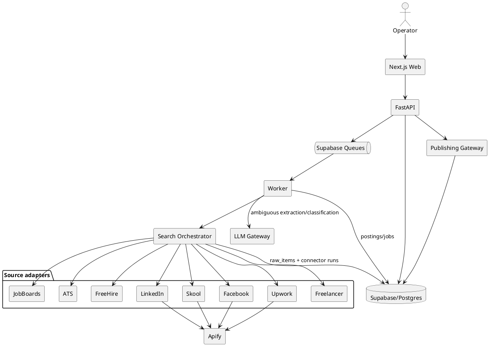
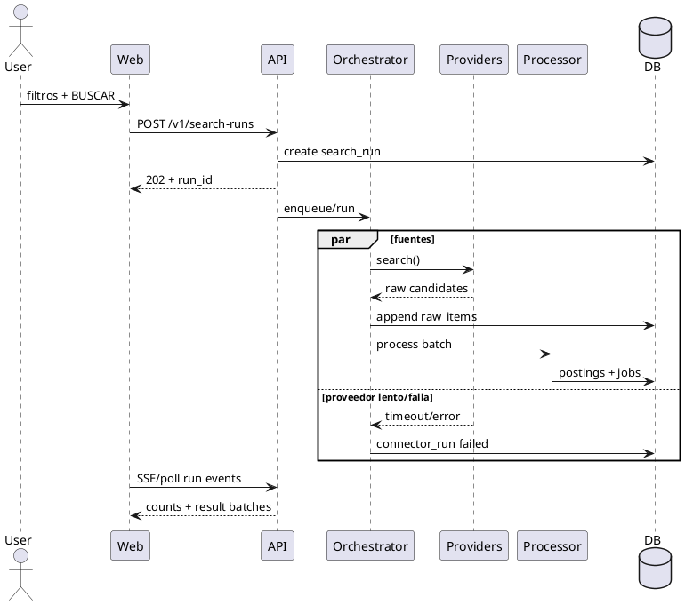

# SPEC-001-Opportunity-Search-Engine

## Background

El producto debe resolver un problema concreto: localizar rápidamente oportunidades laborales relevantes para alumnos de formaciones que prometen conexión con empresas, empezando por perfiles de ventas.

La primera versión no es un portal de empleo ni un CRM de alumnos. Es un motor interno de búsqueda, inteligencia y distribución de oportunidades.

La interacción principal es bajo demanda:

```text
Usuario define:
Closer + España + remoto + >= 2.000 EUR + español + últimas 72h
                              |
                              v
                        [ BUSCAR ]
                              |
                              v
                  búsqueda multi-fuente
                              |
                      100–300 candidatos
                              |
      normalización -> filtros -> IA -> dedupe -> ranking
                              |
                              v
                 20–30 oportunidades útiles
                              |
               ver / exportar / copiar / publicar
```

El mismo motor debe poder ejecutarse posteriormente de forma programada mediante búsquedas guardadas.

El valor no está en un scraper concreto. Está en la combinación de:

- cobertura multi-fuente;
- normalización;
- relevancia;
- deduplicación;
- vigencia;
- resiliencia frente a cambios de proveedores;
- publicación/reutilización del resultado.

## Requirements

### MUST

- **M1. Búsqueda bajo demanda.** Crear una consulta con rol/keywords, ubicación, remoto, compensación, idioma, experiencia, fecha y fuentes.
- **M2. Ejecución multi-fuente paralela.** Las fuentes elegidas se consultan en paralelo.
- **M3. Resultados progresivos.** La UI muestra resultados antes de que termine la fuente más lenta.
- **M4. Cobertura crítica.** LinkedIn, Skool, Facebook Groups y Upwork tienen adaptadores desde el MVP.
- **M5. Independencia de cuentas personales.** El flujo normal no requiere usuario, contraseña o cookies de las cuentas personales del operador.
- **M6. Multi-proveedor.** Cada fuente puede tener proveedor primario, fallback y proveedor deshabilitado por health.
- **M7. 100–300 candidatos.** En una búsqueda suficientemente amplia, recuperar candidatos de sobra y filtrar después.
- **M8. 20–30 resultados utilizables.** Cuando exista oferta suficiente, el resultado final busca ese rango, sin sacrificar criterios estrictos.
- **M9. Raw inmutable.** Toda captura se conserva antes de transformar.
- **M10. Modelo universal.** Todo proveedor termina en un `JobPosting` normalizado y eventualmente un `Job` canónico.
- **M11. Dedupe seguro.** Evitar falsos merges; similitud semántica solo propone candidatos.
- **M12. Trazabilidad.** Todo campo crítico debe poder vincularse a fuente/proveedor/captura.
- **M13. Vigencia.** Diferenciar publicación, descubrimiento, última observación y estado.
- **M14. Exportación.** CSV, XLSX y JSON.
- **M15. Publicación.** Preview + copiar + API/webhook; Discord/Telegram/genérico como primeros destinos.
- **M16. Partial success.** Una fuente caída no invalida el resto de la búsqueda.
- **M17. Observabilidad.** Latencia, errores, candidatos, aceptados, duplicados y costes por fuente/proveedor.
- **M18. Seguridad.** Secretos server-side; RLS; auditoría de acciones administrativas.
- **M19. Idempotencia.** Webhooks, ingestión y tareas reintentables no pueden crear registros duplicados.
- **M20. Contratos versionados.** Schemas, prompts, extractores y conectores tienen versión.

### SHOULD

- **S1. Búsquedas guardadas.**
- **S2. Ejecución programada.**
- **S3. Taxonomía configurable de roles y alias.**
- **S4. Plantillas de publicación configurables.**
- **S5. Revalidación periódica de ofertas.
- **S6. Health/circuit breaker por proveedor.**
- **S7. Filtros de salario en modo `strict` o `prefer`.**
- **S8. Evaluación humana de precisión/recall mediante gold set.**
- **S9. Fuente manual por URL/texto como último fallback universal.**

### COULD

- Perfiles de alumnos.
- Matching estudiante/oferta.
- Favoritos.
- Tracking de aplicaciones.
- CRM.
- Enriquecimiento avanzado de contactos.
- Extensión de navegador.
- Recomendaciones personalizadas.
- Destinos adicionales.
- Aprendizaje de pesos de ranking a partir de resultados reales.

### WON'T — MVP

- Autoapply.
- Mensajería automática a recruiters.
- Portal completo para alumnos.
- ML propio entrenado.
- Kafka/Kubernetes/arquitectura para millones de eventos.
- Dependencia obligatoria de una sesión personal en una red social.

## Method

### 1. Arquitectura lógica



### 2. Arquitectura de dominio

```text
Source
  |
  +-- SourceProvider (A/B/C, capabilities, health, cost)
  |
SearchDefinition
  |
SearchRun
  |
  +-- ConnectorRun
          |
          v
       RawItem (immutable)
          |
          v
       JobPosting
          |
    candidate links
          |
          v
        Job (canonical)
          |
      +---+---+
      |       |
   Company   Tags
```

`RawItem` es la evidencia original.

`JobPosting` es la interpretación de una publicación concreta en LinkedIn, Skool, Facebook, Upwork, etc.

`Job` es la oportunidad canónica. Puede tener muchas publicaciones.

### 3. Contrato de conector

Todo conector implementa conceptualmente:

```python
class SearchConnector:
    source: SourceCode
    provider: ProviderCode
    capabilities: ConnectorCapabilities

    async def search(self, query, context) -> SearchBatch: ...
    async def healthcheck(self) -> HealthResult: ...
```

No se permite lógica específica de LinkedIn/Skool/Facebook en el orquestador.

### 4. Flujo de búsqueda



### 5. Pipeline

```text
raw
 -> deterministic extraction
 -> normalization
 -> schema validation
 -> hard filters
 -> LLM extraction/classification only where needed
 -> duplicate candidate generation
 -> deterministic/threshold merge decision
 -> ranking
 -> publishable result
```

### 6. Dedupe

Orden de señales:

1. `source + external_id`;
2. URL canónica;
3. dominio/empresa + título normalizado + ubicación;
4. fingerprint de contenido;
5. similitud textual/semántica como evidencia adicional.

Regla: un score semántico por sí solo no fusiona automáticamente.

### 7. Ranking

Guardar scores independientes:

- `relevance_score`
- `freshness_score`
- `compensation_score`
- `location_score`
- `completeness_score`
- `source_quality_score`
- `confidence_score`

Pesos iniciales configurables:

```text
ranking =
  0.35 relevance
+ 0.20 freshness
+ 0.15 compensation
+ 0.10 location
+ 0.10 completeness
+ 0.05 source_quality
+ 0.05 confidence
```

No es un modelo opaco; los pesos viven en configuración/versionado.

### 8. Consulta y expansión

Una consulta de usuario se transforma en una `SearchDefinition`.

Ejemplo de rol `closer`:

```text
closer
sales closer
high ticket closer
remote closer
sales consultant
ejecutivo comercial
ejecutivo de ventas
especialista en cierre
```

La taxonomía es controlada, editable y versionada.

### 9. Fuentes y proveedores

**LinkedIn:** proveedor externo/API alternativa como primario; JobSpy puede ser fallback/complemento.

**Skool:** proveedor especializado para superficies accesibles; private/member-only se trata como capacidad explícita y no se asume disponible anónimamente.

**Facebook:** proveedor para grupos públicos conocidos y/o búsqueda pública; private/member-only requiere otra capacidad y no debe usar la cuenta personal como requisito del producto.

**Upwork:** proveedor especializado de búsqueda pública; fallback alternativo.

**Freelancer:** preferencia por API oficial OAuth.

**ATS:** adaptadores directos / catálogo FreeHire / scraper ATS.

### 10. Tecnología base

- Frontend: Next.js 16.3.3 + React 19.3.
- Backend: FastAPI 0.141.1.
- DB/Auth/Queues: Supabase/PostgreSQL.
- Scraping/orquestación externa: Apify.
- Cliente Apify Python: 3.2.x.
- Jobs async: Supabase Queues + worker propio.
- Streaming UI: SSE con polling de fallback.
- Contratos: Pydantic + JSON Schema/OpenAPI.
- Tests backend: pytest.
- Tests frontend: unit/component + Playwright E2E.
- CI: lint + typecheck + tests + migration check.

### 11. Estrategia de resiliencia

Cada proveedor tiene:

- prioridad;
- timeout;
- max results;
- max retries;
- circuit breaker;
- health state;
- coste registrado;
- `supports_*`.

Estados de provider:

```text
healthy
degraded
disabled
unknown
```

Estados de búsqueda:

```text
queued
running
processing
completed
partial
failed
cancelled
```

## Implementation

La implementación se ejecuta en las fases de `phases/`.

Orden:

1. Foundation.
2. Dominio + DB.
3. Orquestador + conectores mock.
4. Fuentes críticas.
5. Fuentes complementarias.
6. Procesamiento/dedupe/ranking.
7. Web.
8. Export/publicación.
9. Saved searches/scheduler.
10. Hardening.
11. Acceptance.

Cada fase debe dejar:

- código;
- migraciones;
- tests;
- documentación;
- criterios de aceptación verdes;
- ADR si cambia una decisión arquitectónica.

## Milestones

### Milestone A — Vertical slice
Una búsqueda creada desde API ejecuta un conector mock y uno real, guarda raw/posting/job y muestra resultado.

### Milestone B — Critical sources
LinkedIn + Skool + Facebook + Upwork integrados mediante proveedores reemplazables.

### Milestone C — Quality engine
Filtros, clasificación, dedupe y ranking producen resultados explicables.

### Milestone D — Operator UI
Búsqueda, progreso, tabla, detalle y selección.

### Milestone E — Distribution
Export CSV/XLSX/JSON + copiar + publicar por Discord/Telegram/webhook.

### Milestone F — Automation
Saved searches + schedule + revalidación.

### Milestone G — MVP accepted
Pruebas sobre búsquedas reales y objetivos de calidad alcanzados.

## Gathering Results

### Métricas de producto

- candidatos recuperados por búsqueda;
- resultados finales;
- `% relevant`;
- `% duplicates visible`;
- `% false merges`;
- `% with useful apply URL/contact`;
- `% active`;
- tiempo a primer resultado;
- tiempo a búsqueda completa;
- coste por búsqueda;
- distribución por fuente;
- publicación/exportación exitosa.

### Gold set

Crear al menos 200 elementos etiquetados manualmente:

```text
relevant / not_relevant
role
location_fit
salary_fit
duplicate_group
active
```

Mínimos de salida para MVP:

- `classification precision >= 90%`
- `classification recall >= 85%`
- `duplicate precision >= 95%`
- `false merge rate < 1%`
- `traceability = 100%`
- `p95 time-to-first-results <= 60s` para proveedores rápidos
- `p95 search completion <= 5 min` excluyendo proveedores declarados `degraded`
- fallo de una fuente => estado `partial`, con resultados del resto
- exportación/publicación idempotente

El objetivo de 20–30 oportunidades es un objetivo de producto condicionado a que exista oferta suficiente; el sistema no debe fabricar ni relajar silenciosamente filtros obligatorios para completar el cupo.

## Need Professional Help in Developing Your Architecture?

Please contact me at [sammuti.com](https://sammuti.com) :)
