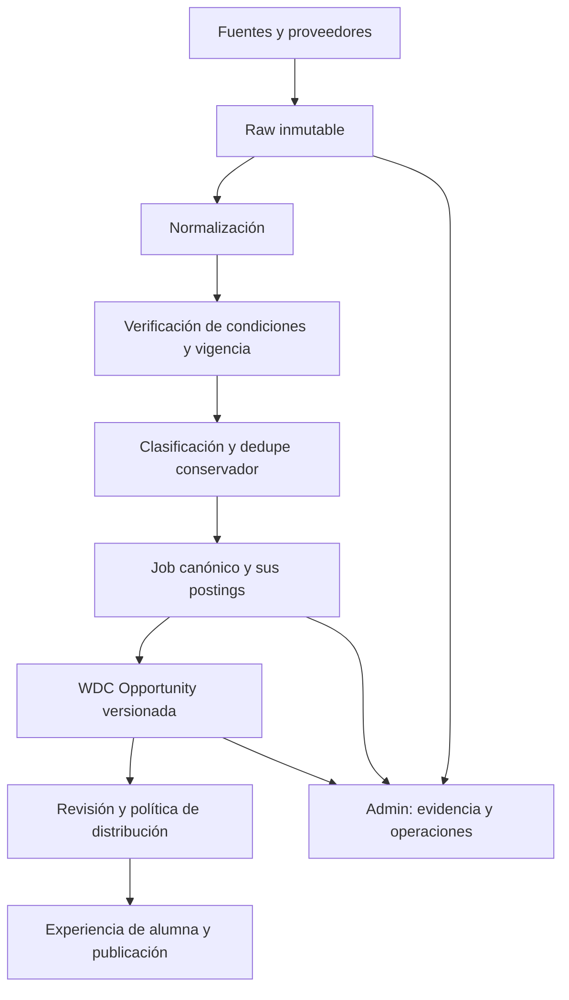

# WDC Opportunity: contrato de experiencia

Decisión de producto 2026-09-22; pendiente de implementación. Para administración: motor de inteligencia y agregación. Para alumnas: conexión con empresas y oportunidades profesionales. Misma evidencia, permisos y proyecciones diferentes.

## Pipeline



Se puede clasificar provisionalmente antes de verificar para ahorrar trabajo; nunca afirmar vigencia por clasificación. La presentación no reemplaza job/posting/raw ni reescribe su evidencia.

## DTO de alumna

`WDCOpportunity`: id, version, headline, company_name nullable, role, short_summary, what_they_are_looking_for[], what_you_would_do[], compensation_summary, location_summary, language_requirements[], experience_summary, why_it_may_be_interesting[], published_at nullable, published_relative (derivado), opportunity_status, status_reason, last_verified_at nullable, next_step, application_type, application_url nullable, connection_type, attribution[] y eligibility_summary.

Campos desconocidos dicen “No especificado”; empresa desconocida nunca se sustituye por la plataforma o por WDC. `why_it_may_be_interesting` explica condiciones observadas, no garantiza ingresos o encaje personal. No usar “para ti” como personalización hasta disponer de perfil/matching real.

## Jerarquía visual

Empresa → puesto → modalidad/mercado → compensación → idioma/experiencia → qué buscan/qué harías → estado/fecha → siguiente paso. Ficha sin columna prominente de fuente, proveedor ni score técnico. Fuente accesible en detalles y atribución visible en el lugar que exija su política. No ocultar atribución obligatoria detrás de clicks si debe ser visible.

Ejemplo ficticio exclusivo para diseño, nunca seed de producción:

```text
ACME
Buscan: Closer de Ventas
Modalidad: 100% remoto · desde España
Compensación: 2.000 EUR/mes de base + comisiones
Potencial anunciado: 3.500–5.000 EUR/mes (variable, no garantizado)
Idioma: Español · Experiencia: 1+ año
Qué buscan: experiencia en venta consultiva
Qué harías: atender llamadas y cerrar ventas
Activa · verificada hoy · publicada hace 2 días
Siguiente paso: continuar candidatura
[Ver oportunidad]
```

Cada cifra del producto real necesita evidencia. OTE/potencial solo si declarado por empleador, separado del fijo; nunca calcular promesas usando comisión hipotética.

## Relación y aplicación

`connection_type` describe la relación demostrada de WDC con esta oportunidad, no el dominio del enlace.

| connection_type | Condición | Acción y mensaje |
|---|---|---|
| direct_partner | Acuerdo vigente con empresa y canal autorizado | Solicitar conexión; “WDC te conecta directamente con…” |
| direct_recruiter | Relación verificada con recruiter autorizado para la vacante | Solicitar conexión / contactar recruiter; identificar intermediación |
| direct_company | Empresa proporcionó la necesidad o canal a WDC, evidencia registrada | Enviar candidatura / contactar empresa según canal |
| external_application | Oferta pública, incluido ATS de la propia empresa, sin relación WDC | Aplicar ahora; oportunidad encontrada/seleccionada por WDC |
| marketplace_application | Candidatura obligatoria dentro de marketplace | Continuar candidatura; indicar plataforma y posible cuenta |
| community_opportunity | Post público con canal de contacto verificable | Ver proceso / contactar anunciante, sin presumir identidad empresarial |

`application_type = company_ats | external_platform | marketplace | wdc_referral | email | contact_form | community_contact | unknown`.
next_step = {action, label, destination_label, destination_domain, requires_account, enabled, disabled_reason}. Servidor deriva acción con reglas, no texto libre del LLM. Leer fuente corporativa no crea direct_company. Un enlace a recruiter no crea direct_recruiter. Ante evidencia de relación revocada, retirar CTA directo y reevaluar.

Si se redirige fuera, anunciar destino real: “Continuarás en Workana para presentar tu candidatura”. “Proceso de candidatura de la empresa” solo si eso está comprobado; no disfrazar marketplace de canal directo. CTA no ejecuta envíos al abrirse. Registrar click no equivale a applied.

“WDC ha seleccionado…” requiere revisión editorial o regla de selección aprobada registrada. “La empresa está recibiendo candidaturas” requiere verificación vigente. “WDC ha encontrado…” se puede usar con descubrimiento documentado. No usar “colaboradora”, exclusividad ni contratación garantizada sin evidencia.

## Vigencia y fechas

Estados visibles: active → 🟢 Activa; verifying → 🟡 Verificando; closed → 🔴 Cerrada. Texto/icono además del color. Estado editorial separado: draft, needs_review, approved, published, withdrawn.

Fecha original, discovered_at, first_seen_at, last_seen_at, last_verified_at, verified_until y closed_at son diferentes. published_relative se calcula al mostrar, con zona de presentación y timestamp original; fecha desconocida = “Fecha de publicación no disponible”. No convertir first_seen en “Publicada hoy”. Repost solo como republicación cuando exista evidencia.

Activa exige señal positiva reciente de candidatura abierta y plazo no vencido. HTTP 200 o presencia en un feed no bastan. TTL inicial configurable 24 h para comunidad y 72 h para job board/ATS, sujeto a política más estricta del proveedor. Al vencer TTL o ante conflicto/timeout: verifying. Cierre explícito/plazo vencido: closed. Un 403/429 no prueba cierre. Reapertura necesita nueva verificación positiva.

Solo approved/published + active + elegibilidad compatible llegan al feed principal. Verifying puede ir a sección separada con motivo, sin “Aplicar ahora” habilitado; closed deja detalle histórico, sin candidatura. Antes de redirigir revalidar si venció TTL. Si todas las fuentes fallan no inventar actividad.

## Admin

Ver source/provider/source_url/canonical_url/external_id/raw/postings/scrape_run, intentos y proveedor usado, duplicados, first_seen/last_verified, confianza por campo, ranking orientativo, coste/tokens, versiones y evidencia de relación. Corregir genera nueva revisión con auditoría; nunca altera raw. Preview de alumna usa exactamente el DTO permitido y el renderer de publicación.
